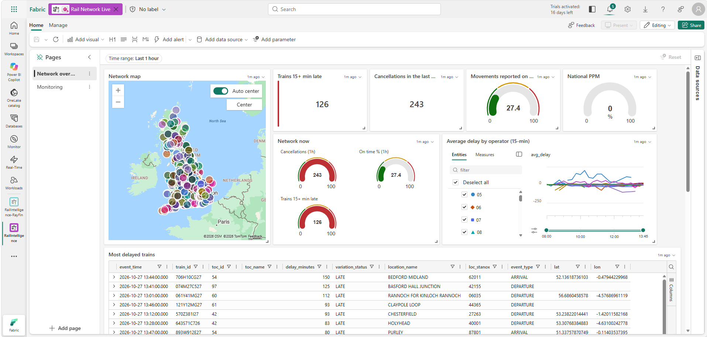
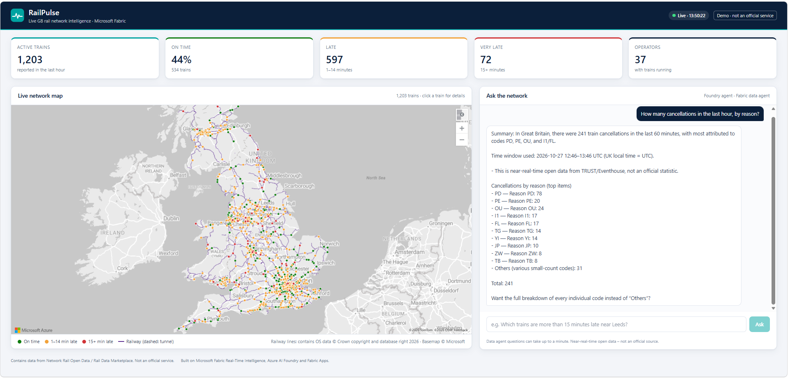
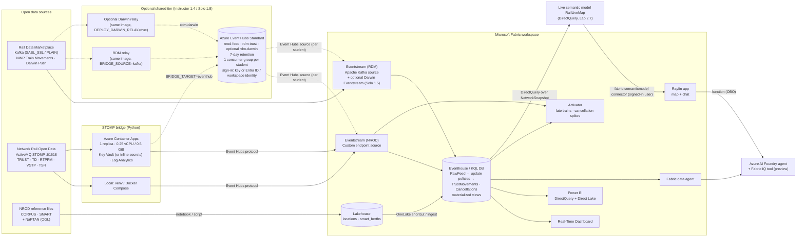

# Real-Time Rail Intelligence on Microsoft Fabric

A hands-on, staged lab series that streams **live Great Britain rail data** into **Microsoft Fabric Real-Time
Intelligence**, turns it into dashboards and alerts, and lets people **chat with the network** through a
Fabric data agent, an Azure AI Foundry agent and a Rayfin (Fabric Apps) web app.

You can use it in two ways:

* **Deploy as-is.** Run the scripts in each lab (Option A) to get a working end-to-end solution quickly.
* **Learn step by step.** Follow the manual portal instructions (Option B) in each lab as a training course.

## What you'll build

**A live operations dashboard (Lab 2.3).** A Real-Time Dashboard over the KQL database: a network map, KPI tiles,
gauges, delay trends by operator and a table of the most delayed trains, refreshing automatically.



**RailPulse, a Rayfin (Fabric Apps) web app (Labs 2.7, 2.8 and 2.9).** A live map of trains with KPI tiles, plus
an "Ask the network" chat panel that answers questions through the Foundry agent and Fabric IQ.



## Presentation

The slide deck [Real-Time-Rail-Intelligence-on-Microsoft-Fabric.pptx](docs/presentation/Real-Time-Rail-Intelligence-on-Microsoft-Fabric.pptx)
covers the architecture, the design choices and the four-week PoC plan. It also has one slide per lab, with what you do,
what to watch out for and the concept behind it (for example JSON ingestion mappings and update policies).
Use it to introduce the labs or to run a class. Download it from GitHub to open it in PowerPoint.

## Choose your path

Part 1 gets live data into your Fabric workspace and comes in three versions. Pick **one** and follow its folder top to
bottom. Part 2 is the same build for everyone. Read [Start here](docs/start-here.md) first.

| You are… | Part 1 | Then |
|---|---|---|
| **Solo builder** – your own accounts, doing everything yourself | [`docs/solo/`](docs/solo/README.md) | [`docs/build/`](docs/build/README.md) |
| **Instructor** – setting up a class | [`docs/instructor/`](docs/instructor/README.md) | Run [`docs/build/`](docs/build/README.md) yourself before the class |
| **Classroom student** – you've been given a handout by your instructor | [`docs/student/`](docs/student/README.md) | [`docs/build/`](docs/build/README.md) |

> **Size your Fabric capacity first.** Always-on Eventstreams use capacity all day, every day. F2 is the minimum for one
> live feed; two Kafka feeds can throttle an F2. See [Capacity planning and sizing](docs/capacity-planning.md), especially for classes.

> **Not an official service.** The repo uses open data from Network Rail and the Rail Data Marketplace.
> Credit the data source. Don't call your app "official" and don't use Network Rail or National Rail logos.
> See [Licensing and attribution](#licensing-and-attribution).

---

## Architecture



| Layer | Choice | Why |
|---|---|---|
| Kafka ingestion | Eventstream **Apache Kafka** source | Rail Data Marketplace exposes Kafka with SASL_SSL/PLAIN. No code needed |
| STOMP ingestion | Python bridge → Eventstream **custom endpoint** (Event Hubs protocol) | Eventstream has no STOMP source |
| Optional shared tier | **Azure Event Hubs Standard** between the sources and Fabric ([Instructor 1.4](docs/instructor/1.4-shared-event-hub.md) / [Solo 1.8](docs/solo/1.8-shared-event-hub.md)) | One instructor ingestion feeds many students' workspaces, and data keeps buffering (7 days) while a capacity is paused. Students sign in with a key, or with their **workspace identity** where a policy blocks keys. An optional Darwin relay adds a Darwin class feed. Direct paths stay the default |
| Bridge hosting | **Azure Container Apps**, exactly 1 replica | A long-lived connection that must be single-instance per durable client-id. Costs about $14/month at list price |
| Storage and query | **Eventhouse** (KQL) and **Lakehouse** | Update policies parse batched TRUST JSON. Materialized views hold the current state |
| Insight | Real-Time Dashboard, Power BI, Activator | Live tiles, history and alerts |
| AI | Fabric data agent → Foundry agent → Rayfin app | Ask questions in natural language, with the user's own identity |

## Lab index

| Page | What it covers | Time | Automated? |
|---|---|---|---|
| [Start here](docs/start-here.md) | Overview, architecture, costs, licensing, preview caveats, choose your path | 20 min | – |
| [Capacity planning](docs/capacity-planning.md) | *Reference:* Fabric capacity planning and sizing (single builder and classrooms) | 15 min | – |

### Part 1 – Solo

| Page | What it covers | Time | Automated? |
|---|---|---|---|
| [Solo 1.1](docs/solo/1.1-prerequisites.md) | Prerequisites and accounts (NROD, RDM, Azure, Fabric, tenant settings, tools, Key Vault) | 45 min (+ approval wait) | Key Vault: ✅ `create-keyvault.sh/.ps1` |
| [Solo 1.2](docs/solo/1.2-fabric-workspace.md) | Fabric workspace, Eventhouse, KQL database, Lakehouse, Eventstreams | 20 min | ✅ `fabric-setup.sh/.ps1` |
| [Solo 1.3](docs/solo/1.3-reference-data.md) | Reference data (CORPUS, SMART, NaPTAN) → Lakehouse and KQL | 30 min | ✅ `load_reference_data.py` / notebook |
| [Solo 1.4](docs/solo/1.4-rdm-kafka-eventstream.md) | Ingest RDM Train Movements with Eventstream | 30 min | Manual (portal) |
| [Solo 1.5](docs/solo/1.5-darwin-push-port.md) | *Optional:* Darwin Push Port: forecasts, platforms → `DarwinLocations` | 25 min | Manual (portal); KQL via `apply_kql.py` |
| [Solo 1.6](docs/solo/1.6-bridge-local.md) | STOMP bridge running locally (venv and Docker): console → file → Eventstream | 40 min | ✅ `run-local.sh/.ps1` |
| [Solo 1.7](docs/solo/1.7-bridge-azure.md) | STOMP bridge on Azure Container Apps (Bicep) | 30 min | ✅ `deploy-bridge.sh/.ps1` |
| [Solo 1.8](docs/solo/1.8-shared-event-hub.md) | *Optional:* shared Azure Event Hub, so data keeps buffering while your capacity is paused (`EVENTHUB_AUTH=entra` if a policy blocks keys) | 30 min | ✅ `create-eventhub.sh/.ps1`; Eventstream source manual |

### Part 1 – Instructor

| Page | What it covers | Time | Automated? |
|---|---|---|---|
| [Instructor 1.1](docs/instructor/1.1-prepare.md) | Solo 1.1, plus tenant settings for the student group, class capacity sizing, shared Foundry project and roles | 60 min (+ approval wait) | Manual |
| [Instructor 1.2](docs/instructor/1.2-workspace-and-reference-data.md) | Solo 1.2 and Solo 1.3 (Option A2), then share the reference Lakehouse | 50 min | ✅ scripts / notebook; sharing manual |
| [Instructor 1.3](docs/instructor/1.3-bridge.md) | Solo 1.6 (local test) and Solo 1.7 (deploy) | 70 min | ✅ `run-local`, `deploy-bridge` |
| [Instructor 1.4](docs/instructor/1.4-shared-event-hub.md) | Shared Azure Event Hub, consumer groups, RDM Kafka relay and optional Darwin relay: the feed for the class | 30 min | ✅ `create-eventhub.sh/.ps1`, `add-student-consumer-groups.sh/.ps1`, `grant-eventhub-reader.sh/.ps1`, `deploy-bridge` |
| [Instructor 1.5](docs/instructor/1.5-student-workspaces-and-handout.md) | Student workspaces, Foundry access, the student handout, a dry run | 30 min | ✅ `make-handouts.sh/.ps1` (+ `fabric-setup` loop); rest manual |
| [Instructor 1.6](docs/instructor/1.6-running-the-class.md) | On the day: capacity, common problems, overnight pause checkpoint | – | Manual |
| [Instructor 1.7](docs/instructor/1.7-after-the-class.md) | After the class: keys or workspace identity roles, Event Hub, Foundry roles, clean-up | 15 min | Partly (`cleanup.sh/.ps1`) |

### Part 1 – Student

| Page | What it covers | Time | Automated? |
|---|---|---|---|
| [Student 1.1](docs/student/1.1-get-ready.md) | Fabric access check, tools, clone and `.env` from the handout | 20 min | Manual |
| [Student 1.2](docs/student/1.2-fabric-workspace.md) | Your workspace, Eventhouse, KQL database, Lakehouse, Eventstreams, raw tables | 20 min | ✅ `fabric-setup.sh/.ps1` |
| [Student 1.3](docs/student/1.3-reference-data.md) | Reference data: shortcut to the instructor's Lakehouse | 10 min | Manual (portal) + KQL script |
| [Student 1.4](docs/student/1.4-connect-to-the-class-feed.md) | Azure Event Hubs sources with your own consumer group | 15 min | Manual (portal) |
| [Student 1.5](docs/student/1.5-darwin-class-feed.md) | *Optional:* Darwin class feed (`rdm-darwin` → `DarwinLocations`), if the instructor runs it | 15 min | Manual (portal) |

### Part 2 – Build (everyone)

| Page | What it covers | Time | Automated? |
|---|---|---|---|
| [Lab 2.1](docs/build/2.1-kql-transformations.md) | KQL tables, update policies, materialized views, functions | 40 min | ✅ `apply_kql.py` |
| [Lab 2.2](docs/build/2.2-activator-alerts.md) | Activator alerts (late trains, cancellation spikes, stalled feed) | 30 min | Manual (portal) |
| [Lab 2.3](docs/build/2.3-dashboard-powerbi.md) | Real-Time Dashboard and Power BI report | 45 min | Manual (queries supplied) |
| [Lab 2.4](docs/build/2.4-fabric-data-agent.md) | Fabric data agent (instructions and example queries) | 30 min | Manual (content supplied) |
| [Lab 2.5](docs/build/2.5-rail-ontology.md) | *Optional:* rail ontology (Fabric IQ): stations, timing points, trains, operators and business rules, plus a data agent grounded in it, compared with Lab 2.4 | 50 min | ✅ `09_ontology_tables.kql`; ontology via the ontology agent or by hand |
| [Lab 2.6](docs/build/2.6-foundry-agent.md) | Foundry agent with the Fabric IQ (OneLake Catalog) tool and a Python client | 30 min | ✅ `foundry/agent_client.py` (after portal connection) |
| [Lab 2.7](docs/build/2.7-live-semantic-model.md) | Live semantic model (DirectQuery over `NetworkSnapshot`) for the app map | 25 min | Manual (Power BI Desktop) |
| [Lab 2.8](docs/build/2.8-rayfin-app.md) | Rayfin app: live map and "chat with the network" | 60 min | CLI + overlay code |
| [Lab 2.9](docs/build/2.9-azure-maps.md) | *Optional:* Azure Maps basemap, satellite view and OS Open Zoomstack railway lines for the app map | 45 min | ✅ `create-azure-maps.sh/.ps1`, `new-azure-maps-sas.sh/.ps1`, `app/tools/build_gb_rail.py` |
| [Lab 2.10](docs/build/2.10-cleanup.md) | Clean-up | 10 min | ✅ `cleanup.sh/.ps1` |

## Fast track (solo builders who've done this before)

**Who this is for:** a solo builder who already has their own NROD and RDM accounts, an Azure subscription and a Fabric
capacity, and wants the scripted parts done quickly. It runs the same scripts as the [solo path](docs/solo/README.md) without
the explanations or checkpoints. **First time? Use [Start here](docs/start-here.md) instead.**

- **Running a class?** Use the [Instructor path](docs/instructor/README.md).
- **A classroom student?** Use the [Student path](docs/student/README.md). You don't need any of the commands below.

Before you start you need:
- the accounts and tenant settings from [Solo 1.1](docs/solo/1.1-prerequisites.md);
- a Fabric capacity sized for the feeds you'll run ([Capacity planning and sizing](docs/capacity-planning.md));
- the Azure CLI (`az login`) and Python 3.11+. Docker is optional.

```bash
git clone https://github.com/<you>/rail-fabric-rti.git && cd rail-fabric-rti
cp .env.example .env            # fill in NROD_*, AZ_*, FABRIC_CAPACITY_ID ...

# 0. Try the bridge offline. No accounts needed: it replays the bundled sample messages
./scripts/run-local.sh venv console --replay

# 1. Key Vault with your NROD credentials (Solo 1.1, step 8). Copy KEY_VAULT_* into .env
./scripts/create-keyvault.sh

# 2. Fabric items (Solo 1.2). Copy the IDs it prints into .env
./scripts/fabric-setup.sh

# 3. KQL schema, update policies and views (Lab 2.1, Option A; run before you send any data)
python -m pip install -r fabric/scripts/requirements.txt
python fabric/scripts/apply_kql.py

# 4. Reference data (Solo 1.3)
python fabric/scripts/load_reference_data.py --to-kql --to-onelake

# 5. PORTAL: in RailEventstreamNrod add a Custom endpoint source, copy its Event Hub connection string
#    into EVENTSTREAM_CONNECTION_STRING, add an Eventhouse destination (RailKQL, Direct ingestion) and
#    publish. Don't pick the table yet (Solo 1.6, section A2, steps 1-4)

# 6. Bridge on Azure Container Apps (Solo 1.7). It starts sending data to the Eventstream
./scripts/deploy-bridge.sh

# 7. PORTAL, once data is arriving: Configure the Eventhouse destination -> existing table RawFeed,
#    JSON, existing mapping RawFeedMapping -> Finish (Solo 1.6, section A2, step 6)
```

On Windows, use the matching `.ps1` scripts, for example `./scripts/create-keyvault.ps1`, `./scripts/fabric-setup.ps1` and
`./scripts/deploy-bridge.ps1`.

Behind a corporate network that blocks Key Vault public access? Set `SECRETS_SOURCE=inline` in `.env` before step 6
(see [Solo 1.7](docs/solo/1.7-bridge-azure.md)).

### Now continue with

1. [Solo 1.4 – RDM Kafka into Eventstream](docs/solo/1.4-rdm-kafka-eventstream.md): the Train Movements feed (portal only).
2. [Solo 1.5 – Darwin Push Port](docs/solo/1.5-darwin-push-port.md) *(optional)*.
3. [Lab 2.1 – KQL transformations](docs/build/2.1-kql-transformations.md): skip the set-up you ran in step 3 and go to the
   **Checkpoint** to confirm the parsed tables are filling.
4. [Lab 2.2](docs/build/2.2-activator-alerts.md) to [Lab 2.8](docs/build/2.8-rayfin-app.md): Activator, dashboard and
   Power BI, data agent, ontology *(2.5, optional)*, Foundry agent, live semantic model and the RailPulse app.
5. [Lab 2.9 – Azure Maps](docs/build/2.9-azure-maps.md) *(optional)*.
6. [Lab 2.10 – Clean-up](docs/build/2.10-cleanup.md) when you've finished, so capacity and Azure costs stop.

Want a shared Event Hub so the feed keeps buffering while your capacity is paused overnight? See
[Solo 1.8](docs/solo/1.8-shared-event-hub.md).
For Darwin forecasts and platforms, add the optional [Solo 1.5](docs/solo/1.5-darwin-push-port.md): its own Eventstream (`RailEventstreamDarwin`, created empty by `fabric-setup`) and raw table (`RdmDarwinRaw`).

### What is automated and what is manual

| Automated (scripts in this repo) | Manual only (step-by-step in the labs) |
|---|---|
| Workspace, Eventhouse, KQL database, Lakehouse and empty Eventstream items (Fabric REST API) | Eventstream **sources/destinations** (Kafka source, custom endpoint, Eventhouse destination) |
| All KQL tables, mappings, update policies, materialized views and functions | Activator rules |
| Reference data download, Lakehouse load and KQL load | Real-Time Dashboard tiles and the Power BI report |
| Bridge: local venv/Docker, Azure infrastructure (Bicep), image build, Key Vault secrets | Fabric data agent creation and publishing |
| *Optional (Instructor 1.4 / Solo 1.8):* Event Hubs namespace, hubs, SAS rules, consumer groups, secrets (Key Vault, `.env` with `SECRETS_SOURCE=inline`, or none with `EVENTHUB_AUTH=entra`), workspace identity role grants (`grant-eventhub-reader`), RDM relay app, optional Darwin relay app, student handouts (`make-handouts`) | Each student's Eventstream **Azure Event Hubs** source and the overnight pause check |
| Foundry agent creation and chat (after the Fabric connection exists) | Foundry Fabric tool connection (portal, or an ARM REST call) |
| CI: lint, tests, Docker build, GHCR push, Bicep lint | Rayfin scaffold and deploy (Rayfin CLI) |

The Eventstream topology, Activator rules, dashboards and data agent can be defined through Fabric item definitions in principle. This repo doesn't generate those payloads, because hand-written definitions are fragile and change often. Those labs give portal steps instead.

## Repository layout

```
├── README.md · LICENSE · CONTRIBUTING.md · .env.example · .gitignore
├── docs/start-here.md         Overview, architecture, costs, licensing, preview caveats and "choose your path"
├── docs/solo/                 Part 1 for a solo builder: Solo 1.1–1.8 (+ README index)
├── docs/instructor/           Part 1 for an instructor: Instructor 1.1–1.7 – class set-up, shared Event Hub, handout, clean-up
├── docs/student/              Part 1 for a classroom student: Student 1.1–1.4 (+ optional 1.5, Darwin)
├── docs/build/                Part 2, the same for everyone: Lab 2.1–2.10
├── docs/capacity-planning.md  Fabric capacity sizing, classroom guidance and throttling recovery
├── docs/presentation/         Slide deck: architecture, PoC plan and one slide per lab
├── docs/images/               Screenshots of the finished dashboard and app (used in this README)
├── src/bridge/                Python STOMP → Eventstream bridge, optional RDM and Darwin Kafka relays (+ Dockerfile, compose, tests)
├── infra/                     Bicep: shared Key Vault (keyvault.bicep); Container Apps env + app(s), Log Analytics, ACR, managed identity (main.bicep);
│                              optional shared Event Hubs namespace (eventhubs.bicep); optional Azure Maps account (azuremaps.bicep, Lab 2.9)
├── scripts/                   run-local / create-keyvault / deploy-bridge / fabric-setup / cleanup, optional create-eventhub /
│                              add-student-consumer-groups / grant-eventhub-reader / make-handouts (.sh and .ps1)
├── fabric/
│   ├── kql/                   01–04 schema scripts, 05 shortcut load, 06 sample queries, 07 TOC seed, 08 one-off back-fill
│   ├── notebooks/             Reference-data notebook (.ipynb)
│   ├── scripts/               apply_kql.py, load_reference_data.py
│   ├── data-agent/            Instructions + example question/KQL pairs
│   ├── ontology/              Lab 2.5: ontology definition (entities, relationships, rules, prompts) + comparison questions
│   ├── dashboard/             Real-Time Dashboard tile queries
│   └── activator/             Activator rule specifications
├── foundry/                   Foundry agent client (Python) + setup notes
├── app/                       Rayfin app starter (overlay files + guide); rayfin-maps-addon/ (Lab 2.9 Azure Maps map); tools/build_gb_rail.py
└── .github/workflows/         bridge-ci, infra-validate
```

## Costs (indicative, check current pricing)

| Item | Indicative cost | Notes |
|---|---|---|
| Azure Container Apps bridge (0.25 vCPU / 0.5 GiB, always on) | **~$14/month** list-price estimate after the monthly free grant | Size up to 0.5 vCPU / 1 GiB for `TD_ALL_SIG_AREA` (~6,000 msgs/min) |
| *Optional:* Event Hubs Standard, 1 TU (Instructor 1.4 / Solo 1.8) | **~$22/month** ($0.03/hour) + ingress $0.028 per million events (≈ $1–4/month for TRUST) | List-price estimates. Basic ($0.015/hour) is unsuitable: 1 consumer group, 1-day retention |
| *Optional:* RDM relay container app (Instructor 1.4 / Solo 1.8) | **~$14/month** | Same size as the bridge. Only with `DEPLOY_RDM_RELAY=true` |
| *Optional:* Darwin relay container app (Instructor 1.4, Darwin class feed) | **~$28/month** (estimate) | 0.5 vCPU / 1 GiB. Only with `DEPLOY_DARWIN_RELAY=true`. Plan 2 or more Event Hubs throughput units (`EVENTHUB_THROUGHPUT_UNITS=2`), which adds about $22/month per extra TU |
| Log Analytics | Pay per GB ingested | The bridge logs a small amount at INFO. Retention is 30 days by default |
| Key Vault, ACR Basic | Small | Use GHCR (`CONTAINER_IMAGE=ghcr.io/...`) to skip ACR |
| Fabric capacity | **F2 minimum for one live feed**; F4 recommended with Darwin (Solo 1.5) or the bridge; classes need more (trial works for most labs) | Always-on Eventstreams use capacity continuously. See [Capacity planning and sizing](docs/capacity-planning.md). Pause pay-as-you-go capacity when you're not using it. The Foundry Fabric tool needs **paid F2+** |
| Azure AI Foundry | Model tokens | The Fabric tool adds a data agent query for each question |
| *Alternative rejected:* Azure Functions Premium/Flex always-ready | ~$80–150+/month | Functions only suit the daily reference-file pull |

Use the [Azure pricing calculator](https://azure.microsoft.com/pricing/calculator/) and the [Fabric pricing page](https://azure.microsoft.com/pricing/details/microsoft-fabric/) for your region.
For Fabric capacity sizing (estimates per Eventstream, sizing by scenario, classrooms and what to do if you're throttled), see
[Capacity planning and sizing](docs/capacity-planning.md).

## Preview and experimental features

* Fabric IQ (OneLake Catalog) tool in Azure AI Foundry: **preview**. It replaces the Fabric data agent tool, which stops being supported on **6 November 2026**. Calls run as the signed-in user; use a background-mode model (gpt-5.4/5.5 recommended).
* Fabric Apps / Rayfin: **preview**. Rayfin 1.36.2 can't query a KQL database (no Kusto connector or token), so Lab 2.8's map reads a DirectQuery semantic model over `RailKQL` (Lab 2.7) through the preview `fabric-semanticmodel` connector; the chat uses a Rayfin function, and functions aren't available in every tenant or region. **Fabric Apps itself isn't available in every Fabric region.** Check *New item → App (preview)* during Part 1 (Solo 1.1 or Instructor 1.1), and see Lab 2.8 for the workaround.
* RDM "NWR Train Movements" is a **beta** product with no SLA.
* Lakehouse "Load Table" REST API: **preview**.

## Licensing and attribution

* Code: [MIT](LICENSE).
* Data: Network Rail open data (Network Rail Infrastructure Limited, Open Government Licence). Rail Data Marketplace products are under the licence shown on each product page. NaPTAN is © Crown copyright (OGL v3.0). You must **attribute** the source wherever you show the data. Don't describe anything as "official", and don't use Network Rail or National Rail logos.
* NROD accounts are capped (about 1,000 users). Use **one** connection for each account, and don't run the local and cloud bridges together with the same client-id. For a class, use the optional shared Event Hub ([Instructor 1.4](docs/instructor/1.4-shared-event-hub.md) / [Solo 1.8](docs/solo/1.8-shared-event-hub.md)) so one connection feeds everyone; check that sharing the data with your students fits the licence terms of each feed.

## Contributing

See [CONTRIBUTING.md](CONTRIBUTING.md).
