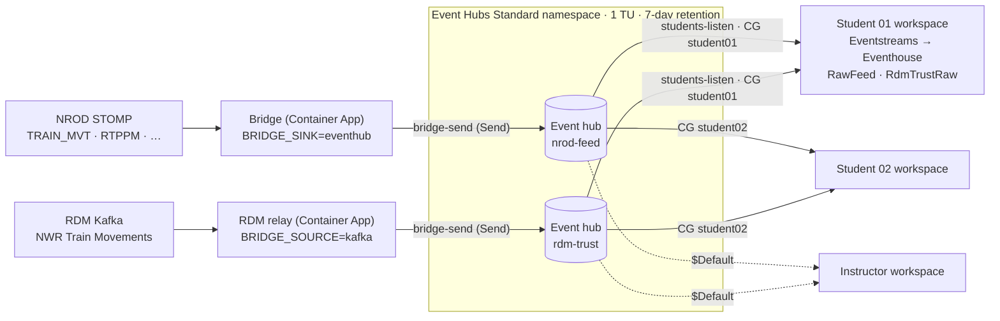

# Instructor 1.4 – Shared Azure Event Hub for the class

**Time:** 30 minutes · **Previous:** [Instructor 1.3](1.3-bridge.md) · **Next:** [Instructor 1.5](1.5-student-workspaces-and-handout.md)

> **This is the step that feeds the class.** Your Azure bridge and an RDM relay send to one Azure Event Hubs namespace, and
> each student's Eventstream reads it with their own consumer group. Students follow
> [Student 1.4](../student/1.4-connect-to-the-class-feed.md) to connect. A solo builder who only wants to pause a capacity
> overnight uses [Solo 1.8](../solo/1.8-shared-event-hub.md) instead.

## Objectives

* Put an **Azure Event Hubs (Standard)** namespace between the rail data sources and Fabric.
* Run **one** instructor-owned ingestion (the NROD bridge, plus an RDM Kafka relay) that feeds **many** students,
  each with their own Fabric workspace, Eventstream and Eventhouse.
* Keep data flowing while a Fabric capacity is **paused overnight**, and let each Eventstream catch up when it resumes.

## When to use it

| Situation | Direct paths (default) | Shared Event Hub (this page) |
|---|---|---|
| One person, capacity always on | ✅ Simplest | Not needed |
| A class of students, each building their own pipeline | ❌ NROD allows **one connection per account**, and RDM subscriptions are **per user**, so each student needs their own accounts | ✅ One NROD connection and one RDM subscription (the instructor's) feed everyone |
| Capacity paused overnight or at weekends | ❌ Bridge sends fail while the capacity is paused (see below) | ✅ Event Hubs keeps buffering for up to **7 days** |
| More than 19 students | – | Needs a second namespace or Premium (see [Limits](#limits-that-shape-the-design)) |

### What happens to data while the capacity is paused?

* **Direct path (custom endpoint).** The bridge only ACKs a STOMP frame after the sink accepts it. While the capacity is
  paused, sends to the Eventstream custom endpoint are expected to fail (*validate this in your tenant – the exact error
  isn't documented*). Each failure raises `SinkError`: the bridge does **not** ACK the frame, increments `send_failures`,
  disconnects and reconnects with exponential backoff (30, 60, 120 … seconds, capped at `BACKOFF_MAX_S`, default 600 s; 25 minutes after an NROD `AMQ339009` block), then tries
  again with the redelivered frame. That loop is safe for short outages, but NROD only buffers a durable subscription for
  about **5 minutes**, so anything older than that is lost when the pause lasts longer. The Eventstream **Custom endpoint
  source doesn't support pause and resume** either ([Pause and resume data streams](https://learn.microsoft.com/en-us/fabric/real-time-intelligence/event-streams/pause-resume-data-streams)).
* **Shared Event Hub path.** The bridge and the RDM relay send to Azure Event Hubs, which doesn't depend on the Fabric
  capacity, so they keep running and ACK/commit normally. Event Hubs retains the events (7 days here). The Eventstream
  **Azure Event Hubs source supports pause/resume** with the resume options **When streaming was last stopped**, **Now**
  and **Custom time** (same page), so a student's Eventstream can pick up where it stopped.

> **Be honest with yourself about the overnight behaviour.** Microsoft documents pause/resume of an *Eventstream source*.
> What a source does after a full *capacity* pause and resume should be **validated** with the
> [overnight pause checkpoint](1.6-running-the-class.md#overnight-pause-checkpoint). If the gap isn't back-filled automatically, use the documented
> fallback: **Deactivate** the source and **Activate** it with **Custom time** set to just before the pause.

## Architecture



| Piece | Setting | Why |
|---|---|---|
| Namespace tier | **Standard**, 1 throughput unit (TU) | Basic allows only **1 consumer group** per event hub and **1-day** retention. Standard allows **20 consumer groups** per event hub and up to **7 days** retention, and has a Kafka endpoint |
| Throughput | 1 TU = 1 MB/s (or 1,000 events/s) in, 2 MB/s (or 4,096 events/s) out | Plenty for TRUST and RTPPM. Egress is shared by every reader (see [Costs](#costs-estimates)) |
| Event hubs | `nrod-feed` (bridge envelope JSON → `RawFeed`), `rdm-trust` (raw RDM JSON → `RdmTrustRaw`) | Same tables and mappings as the direct paths |
| Partitions | 2 per hub | Can't be changed later on Standard. Two is enough for these volumes |
| Retention | 7 days (`messageRetentionInDays: 7`) | Standard maximum. Covers nights and weekends |
| Send rule | `bridge-send` (**Send**) on each hub | Stored in Key Vault as `eventhub-nrod-connection-string` / `eventhub-rdm-connection-string` |
| Listen rule | `students-listen` (**Listen**) on the namespace | One key works for both hubs. SAS rules can't be limited to a consumer group, so rotate it after the course |
| Consumer groups | `student01` … on **both** hubs; `$Default` reserved for the instructor | One consumer group per student Eventstream |

### Limits that shape the design

From [Event Hubs quotas and limits](https://learn.microsoft.com/en-us/azure/event-hubs/event-hubs-quotas):

| Limit | Basic | Standard | Premium |
|---|---|---|---|
| Consumer groups per event hub | 1 | **20** | 100 |
| Maximum retention | 1 day | **7 days** | 90 days |
| Non-epoch receivers per consumer group | 5 | 5 | 5 |
| Authorisation rules per namespace | 12 | 12 | 12 |

So: **one consumer group per student Eventstream** (never share one; see [Troubleshooting](#troubleshooting)), and at most
**19 students** per namespace on Standard (`$Default` is the instructor's). For more students, create a second namespace
(re-run the script with a different `EVENTHUB_NAMESPACE` and split the class) or use Premium.

## Costs (estimates)

List prices in USD from the [Event Hubs pricing page](https://azure.microsoft.com/pricing/details/event-hubs/) at the time of
writing. They're **estimates**: check the [Azure pricing calculator](https://azure.microsoft.com/pricing/calculator/) for your region and currency.

| Item | Estimate | Notes |
|---|---|---|
| Event Hubs **Standard**, 1 TU | $0.03/hour ≈ **$22/month** | Charged whether or not anyone reads |
| Ingress events | $0.028 per million | TRUST at ~600 batches/min ≈ 26 million events/month ≈ **$0.73**. The bridge splits batches into one event per message by default (`BRIDGE_SPLIT_BATCHES=true`), which makes it roughly **$3–4/month**. Billing counts each 64 KB of a send as one event |
| RDM relay container app (0.25 vCPU / 0.5 GiB, always on) | **~$14/month** | Only with `DEPLOY_RDM_RELAY=true`. Same estimate as the bridge in Solo 1.7 |
| *Not suitable:* Basic | $0.015/hour per TU | Only 1 consumer group and 1-day retention |

**Egress is shared.** Every student reads every event, so 19 students reading a 12-hour overnight backlog at the same time
share 2 MB/s (4,096 events/s) of egress per TU. As a rough estimate, catching up can take tens of minutes to about an hour
in the morning. Raise to 2 TUs for the catch-up window if that's too slow (`EVENTHUB_THROUGHPUT_UNITS=2` and re-run the script).

### Classroom sizing: Fabric capacity

The shared Event Hub solves the **connection** problem (one NROD connection and one RDM subscription for the class) and
buffers data overnight. It does **not** reduce the **Fabric capacity** each student uses. Every student still runs their own
Eventstream with an Azure Event Hubs source (≈ **1 CU** continuously, as an **estimate** from published rates: 0.222 flat +
processor from 0.778 at *Low*) and their own Eventhouse.

* On one shared capacity, plan roughly **1.5–2 CU per student** (estimate): 5 students ≈ F8–F16, 10 ≈ F16–F32,
  19 ≈ F32–F64. Validate with the Capacity Metrics app before the course.
* Set **workspace-level surge protection** limits on each student workspace, so one student can't starve the others.
* Scale the capacity up for the session and back down (or pause it) afterwards. Remember that catching up after a pause
  adds load.
* For larger classes, consider the shared instructor Eventhouse below, or a separate capacity per student.

See [Capacity planning and sizing](../capacity-planning.md#classrooms-and-shared-capacities).

### The alternative: one shared instructor Eventhouse

Instead of N Eventhouses, the instructor runs the direct pipeline once and students **query** the instructor's Eventhouse
(workspace *Viewer* access or KQL database permissions, or a database shortcut in their own Eventhouse).

* ✅ Simpler and cheaper: no namespace and no student Eventstreams.
* ❌ Students don't build their own ingestion pipeline (Student 1.4 isn't needed, and Lab 2.1 becomes read-only).
* ❌ The shared Eventhouse runs on the instructor's capacity, so it still pauses with that capacity, and the direct
  custom endpoint path still loses data during long pauses.

**Recommendation:** use the shared Event Hub when students each build their own pipeline, or when the capacity is paused nightly.
Use a shared Eventhouse for short demos where students only need to query.

## Prerequisites

**Instructor**

* [Instructor 1.3](1.3-bridge.md) done (Solo 1.1 and 1.7: the shared Key Vault, the Container Apps environment and the bridge exist), with `AZ_RESOURCE_GROUP`,
  `AZ_LOCATION` and `NAME_PREFIX` unchanged.
* For the RDM relay: your RDM *NWR Train Movements* subscription details in `.env` (`RDM_KAFKA_*`, see Solo 1.4).
  **Stop the Eventstream Apache Kafka source** in your own workspace if it uses the same RDM consumer group, or the two
  consumers will split the partitions between them.

**What each student needs** (you set this up in [Instructor 1.5](1.5-student-workspaces-and-handout.md))

* Their own workspace with an Eventhouse, KQL database and the two Eventstreams (Student 1.2), and the Lab 2.1 tables and
  mappings (`python fabric/scripts/apply_kql.py`).
* From the instructor: the **namespace name**, the **key name** `students-listen`, the **key**, and **their own consumer group** (for example `student07`).
* Students **don't** need their own NROD or RDM accounts in this mode.

## Option A – automated (instructor)

1. Set the optional variables in `.env` (see `.env.example`):

   ```bash
   STUDENT_CONSUMER_GROUP_PREFIX=student
   STUDENT_CONSUMER_GROUP_COUNT=15        # student01 … student15 (max 19)
   EVENTHUB_THROUGHPUT_UNITS=1
   EVENTHUB_RETENTION_DAYS=7
   ```

2. Create the namespace, hubs, rules, Key Vault secrets (or `.env` values) and consumer groups:

   ```bash
   ./scripts/create-eventhub.sh --what-if     # optional preview
   ./scripts/create-eventhub.sh               # or: ./scripts/create-eventhub.ps1  (-HideKey to not print the Listen key)
   ```

   What it does:
   1. Deploys `infra/keyvault.bicep` again (deployment `shared-keyvault`), which re-uses the Solo 1.1 vault and makes sure you can write secrets.
   2. Deploys `infra/eventhubs.bicep` (deployment `shared-eventhubs`): Standard namespace, `nrod-feed` and `rdm-trust`
      (2 partitions, 7 days), `bridge-send` (Send) per hub and `students-listen` (Listen) on the namespace.
   3. Reads each `bridge-send` connection string with `az eventhubs eventhub authorization-rule keys list` and stores them as
      Key Vault secrets `eventhub-nrod-connection-string` and `eventhub-rdm-connection-string`.
   4. Creates `student01` … on both hubs with `add-student-consumer-groups`.
   5. Prints `EVENTHUB_NAMESPACE` for your `.env`, and the connection details for students (the Listen key comes from
      `az eventhubs namespace authorization-rule keys list`). **Share the key privately**, never in a repo or a public chat.

   **Key Vault blocked by policy?** If you deployed Solo 1.7 with `SECRETS_SOURCE=inline` (a policy disables public
   access to Key Vault, so the script can't write secrets and Container Apps can't read them), run it with the same choice.
   It then skips Key Vault completely and writes `EVENTHUB_NAMESPACE`, `EVENTHUB_CONNECTION_STRING` (the `nrod-feed`
   **bridge-send** string) and `EVENTHUB_RDM_CONNECTION_STRING` (the `rdm-trust` one) straight into your `.env`:

   ```bash
   SECRETS_SOURCE=inline ./scripts/create-eventhub.sh
   # PowerShell: ./scripts/create-eventhub.ps1 -SecretsSource inline   (or set SECRETS_SOURCE=inline in .env)
   ```

   `.env` then holds send keys for your hubs: keep it private and never commit it. Everything else below is the same.


3. Add more students later (idempotent; existing groups are skipped):

   ```bash
   ./scripts/add-student-consumer-groups.sh --prefix student --count 5 --start 16     # student16 … student20
   ./scripts/add-student-consumer-groups.sh --names alice,bob
   # PowerShell: ./scripts/add-student-consumer-groups.ps1 -Prefix student -Count 5 -Start 16
   ```

   The script stops with an error before a hub would exceed 20 consumer groups.

4. **Point the Azure bridge at the hub and deploy the RDM relay. This is the step that feeds the class.** It re-runs the
   Solo 1.7 script:

   ```bash
   BRIDGE_TARGET=eventhub DEPLOY_RDM_RELAY=true ./scripts/deploy-bridge.sh
   # PowerShell: set BRIDGE_TARGET=eventhub and DEPLOY_RDM_RELAY=true in .env, then ./scripts/deploy-bridge.ps1
   ```

   With `BRIDGE_TARGET=eventhub` the bridge app reads `eventhub-nrod-connection-string` from Key Vault (instead of
   `eventstream-connection-string`) and runs with `BRIDGE_SINK=eventhub`. With `DEPLOY_RDM_RELAY=true` the script stores
   `rdm-kafka-username` and `rdm-kafka-password` in Key Vault and deploys `<NAME_PREFIX>-rdm-relay`: the same image with
   `BRIDGE_SOURCE=kafka`, 1 replica, 0.25 vCPU / 0.5 GiB. To go back to the direct path, re-run with `BRIDGE_TARGET=eventstream`
   (and `DEPLOY_RDM_RELAY=false`; see the note in Solo 1.7 about removing the relay app).

   If you used `SECRETS_SOURCE=inline` in step 2, use it here too. The apps then get their secrets from `.env` instead of
   Key Vault: `EVENTHUB_CONNECTION_STRING` and, with the relay, `EVENTHUB_RDM_CONNECTION_STRING`, which step 2 has
   already written there:

   ```bash
   SECRETS_SOURCE=inline BRIDGE_TARGET=eventhub DEPLOY_RDM_RELAY=true ./scripts/deploy-bridge.sh
   ```

## Option B – manual (instructor, Azure portal)

> Portal labels change from time to time. If a label differs slightly, pick the closest match.

### B1. Namespace

1. **Create a resource** → **Event Hubs** → **Create**.
2. Resource group `rg-rail-fabric-rti`, a globally unique **Namespace name** (for example `railrti-ehns-<something>`),
   **Location** = your bridge region, **Pricing tier** = **Standard**, **Throughput units** = 1, auto-inflate off.
3. **Networking**: public access (Fabric's Event Hubs source needs a publicly reachable namespace unless you set up a managed private endpoint). Minimum TLS 1.2.
4. **Review + create**.

### B2. Event hubs and retention

For each of `nrod-feed` and `rdm-trust`: namespace → **Event Hubs** → **+ Event Hub** → name, **Partition count** 2,
**Cleanup policy** *Delete*, **Retention time** 168 hours (7 days) → **Create**.

### B3. Shared access policies

* On **each event hub** → **Settings** → **Shared access policies** → **Add** → `bridge-send`, tick **Send** only → **Create**.
  Open it and copy the **Connection string–primary key** (it ends with `EntityPath=<hub>`).
* On the **namespace** → **Shared access policies** → **Add** → `students-listen`, tick **Listen** only. Copy its **Primary key** for the students.

### B4. Consumer groups

On each event hub → **Entities** → **Consumer groups** → **+ Consumer group** → `student01`, `student02`, … (the same names on both hubs). Leave `$Default` for yourself.

### B5. Key Vault secrets

```bash
KV=<your vault>   # KEY_VAULT_NAME, from Solo 1.1
az keyvault secret set --vault-name $KV -n eventhub-nrod-connection-string --value "<nrod-feed bridge-send connection string>"
az keyvault secret set --vault-name $KV -n eventhub-rdm-connection-string  --value "<rdm-trust bridge-send connection string>"
az keyvault secret set --vault-name $KV -n rdm-kafka-username --value "<RDM username>"
az keyvault secret set --vault-name $KV -n rdm-kafka-password --value "<RDM password>"
```

Or use the portal (*Key Vault → Secrets → Generate/Import*) to keep secrets out of your shell history.

Using Container Apps secrets instead (Solo 1.7, *inline*)? Skip this step and add the values as **Container Apps secrets** in B6.

### B6. Container apps

**Bridge** (`<prefix>-bridge`) → **Containers** / **Secrets**:
* Add a secret `eventhub-nrod-connection-string` as a **Key Vault reference** (identity = the bridge's user-assigned identity),
  or as a **Container Apps secret** with the value pasted in if you use the inline choice from Solo 1.7.
* Edit the container: `BRIDGE_SINK=eventhub`, add `EVENTHUB_CONNECTION_STRING` → *Reference a secret* → `eventhub-nrod-connection-string`.
  Remove `EVENTSTREAM_CONNECTION_STRING`. **Save as a new revision.**

**RDM relay**: create a second **Container App** in the same environment, named `<prefix>-rdm-relay`: same image and identity,
**0.25 CPU / 0.5 Gi**, **Scale min 1 / max 1**, ingress **disabled**, liveness probe HTTP GET `/healthz` on 8080, secrets
`rdm-kafka-username`, `rdm-kafka-password` and `eventhub-rdm-connection-string` as Key Vault references (or Container Apps secrets
for the inline choice), and these environment variables:

| Name | Value |
|---|---|
| `BRIDGE_SOURCE` | `kafka` |
| `BRIDGE_SINK` | `eventhub` |
| `RDM_KAFKA_BOOTSTRAP_SERVERS`, `RDM_KAFKA_TOPIC`, `RDM_KAFKA_CONSUMER_GROUP` | From your RDM subscription page |
| `RDM_KAFKA_USERNAME` / `RDM_KAFKA_PASSWORD` | *Reference a secret* → `rdm-kafka-username` / `rdm-kafka-password` |
| `EVENTHUB_CONNECTION_STRING` | *Reference a secret* → `eventhub-rdm-connection-string` |
| `HEALTH_PORT` | `8080` |

The relay commits Kafka offsets only after Event Hubs has accepted a batch, and reconnects with backoff when a send fails, so
delivery is **at-least-once** (rare duplicates are possible after a failure).

## Optional: local Event Hub mode

> **Optional, and only after Option A or B.** The class is fed by the **Azure** bridge and relay, which Option A step 4
> points at the shared Event Hub (`BRIDGE_TARGET=eventhub DEPLOY_RDM_RELAY=true ./scripts/deploy-bridge.sh`). That's
> the required step. Use this local mode only to test the hub before deploying, or as a stand-in if the Azure bridge is
> down – and stop it again afterwards: NROD allows one connection per account, and an RDM consumer group one reader.

The local bridge is the one from [Solo 1.6](../solo/1.6-bridge-local.md). `eventhub` is the same Event Hubs producer as
`eventstream`; only the connection string differs.

### Automated (scripts)

Needs the Event Hub from this page and its connection strings in `.env` (see [Manual](#manual-step-by-step) below).

| Step | bash | PowerShell |
|---|---|---|
| Live → shared Event Hub `nrod-feed` (venv) | `./scripts/run-local.sh venv eventhub` | `./scripts/run-local.ps1 -Mode venv -Sink eventhub` |
| RDM Kafka relay → console (venv) | `./scripts/run-local.sh venv console --kafka` | `./scripts/run-local.ps1 -Mode venv -Sink console -Kafka` |
| RDM Kafka relay → Event Hub `rdm-trust` (Docker) | `./scripts/run-local.sh docker eventhub --kafka` | `./scripts/run-local.ps1 -Mode docker -Sink eventhub -Kafka` |

### Manual (step by step)

Run these from `src/bridge` with the virtual environment from Solo 1.6, B1 active.

1. Copy the `nrod-feed` hub's **bridge-send** connection string (Event Hubs namespace → `nrod-feed` → *Shared access policies* →
   `bridge-send`, or the Key Vault secret `eventhub-nrod-connection-string`) into `.env` as `EVENTHUB_CONNECTION_STRING=…`.
   If it's empty, the bridge falls back to `EVENTSTREAM_CONNECTION_STRING`. **Never commit it.**
2. Run `python -m rail_bridge --sink eventhub`.

The **RDM Kafka relay** runs from the same code with `--source kafka` (or `BRIDGE_SOURCE=kafka`). It reads `RDM_KAFKA_*` from `.env`,
forwards each message value unchanged, and commits offsets only after a successful send. The scripts map
`EVENTHUB_RDM_CONNECTION_STRING` (the `rdm-trust` send string) to the relay; the relay never falls back to the Eventstream string.

```bash
EVENTHUB_CONNECTION_STRING="$EVENTHUB_RDM_CONNECTION_STRING" python -m rail_bridge --source kafka --sink eventhub
```

> Only one consumer may use an RDM consumer group at a time. Stop the local relay before the Azure one starts (and pause your
> Solo 1.4 Kafka source if it uses the same group).

## Darwin isn't relayed

The RDM relay forwards **one** topic (NWR Train Movements). For the optional Darwin feed
([Solo 1.5](../solo/1.5-darwin-push-port.md)), either each student uses their own Darwin subscription, or you run a second
relay instance pointed at the Darwin topic, with its own hub and consumer groups. That second relay **isn't scripted** in this repo.

## Instructor checkpoint

```bash
NS=<namespace>; RG=rg-rail-fabric-rti
az eventhubs eventhub consumer-group list -g $RG --namespace-name $NS --eventhub-name nrod-feed --query "[].name" -o tsv
az containerapp logs show -g $RG -n ${NAME_PREFIX:-railrti}-rdm-relay --format text --tail 20
```

* Namespace → **Overview** → *Incoming Messages* rises for both hubs every minute.
* The bridge's `/metrics` (`frames_acked`) and the relay's logs show no repeated `send failed` lines.
* In your own workspace (consumer group `$Default`), follow [Student 1.4](../student/1.4-connect-to-the-class-feed.md) to confirm end-to-end flow.
* Before the class, run the [overnight pause checkpoint](1.6-running-the-class.md#overnight-pause-checkpoint) once.

## Troubleshooting

| Symptom | Likely cause | Fix |
|---|---|---|
| Relay (or bridge) logs `CBS Token authentication failed` | The app is using a key the hub doesn't accept: a wrong or old connection string, or a secret that changed while the app kept running (a Container App only reads secrets when it starts) | Check the string is the `bridge-send` one for the right hub (`rdm-trust` for the relay). Then re-run `deploy-bridge`, which now restarts the apps, or restart by hand: `az containerapp revision restart -g $RG -n <prefix>-rdm-relay --revision <active revision>`. The log's `what to check` line lists these steps |
| `deploy-bridge` stops with `RDM_KAFKA_TOPIC looks like the Darwin Push Port topic` | `RDM_KAFKA_*` in `.env` holds the Darwin subscription, so the relay would send Darwin into `RdmTrustRaw` | Put the **NWR Train Movements** topic, consumer group, username and password in `RDM_KAFKA_*` (the same as your Solo 1.4 Kafka source). Darwin keeps its own source (Solo 1.5) |
| Only `$Default` under the hubs' **Consumer groups**, although `.env` has `STUDENT_CONSUMER_GROUP_COUNT` | `create-eventhub` didn't see a number: older scripts used the **first** of two `STUDENT_CONSUMER_GROUP_COUNT` lines (`.env.example` already has one set to `0`), or the value had a comment after it. The script prints `No student consumer groups created` in that case | Keep one `STUDENT_CONSUMER_GROUP_COUNT` line in `.env`, then run `./scripts/add-student-consumer-groups.sh --prefix student --count 19` (PowerShell: `-Prefix student -Count 19`). It's safe to re-run: existing groups are skipped. The script now warns about duplicate keys and ignores ` # comments` after unquoted values |
| `ParentResourceNotFound ... eventhubs/nrod-feed could not be found` from an `az eventhubs` command | The namespace name is wrong (often a missing last character), or the resource group is different | Copy the name exactly: `az eventhubs namespace list -g $RG --query "[].name" -o tsv` |
| `create-eventhub` stops at the Key Vault step (deployment `shared-keyvault` denied by policy) or keeps printing `waiting for Key Vault permissions` and ends with `could not write secret` | A policy disables public network access to Key Vault (or adds a firewall), so your machine can't write secrets | Re-run with `SECRETS_SOURCE=inline ./scripts/create-eventhub.sh` (PowerShell: `-SecretsSource inline`). The Event Hubs part is idempotent, so re-running is safe. Then deploy with `SECRETS_SOURCE=inline` too (step 4) |
| `QuotaExceeded` (or similar) when creating a consumer group | The hub already has 20 consumer groups (Standard, including `$Default`) | Remove unused groups (`az eventhubs eventhub consumer-group delete`), add a second namespace, or use Premium |
| Bridge or relay logs `Event Hub send failed … ServerBusy` / throttling | More than 1 MB/s or 1,000 events/s in (for example, `TD_ALL_SIG_AREA` bursts) | Raise `EVENTHUB_THROUGHPUT_UNITS` and re-run `create-eventhub` |
| Relay logs SASL authentication errors | Wrong RDM username or password, or the subscription expired | Update the Key Vault secrets `rdm-kafka-username` / `rdm-kafka-password` (inline choice: update `.env` and re-run `deploy-bridge`), then restart the revision |
| Relay runs but `rdm-trust` gets only part of the data | Another consumer (your Solo 1.4 Eventstream Kafka source, or a local relay) uses the same RDM consumer group | Stop the other consumer. Only one reader per RDM consumer group |
| Duplicated rows after a relay or bridge restart | Delivery is at-least-once | De-duplicate in queries, as above |
| `Event Hub send failed …` (sink `eventhub`) | Wrong or rotated SAS key, or `EntityPath` missing, for the shared Event Hub | Use the hub-level `bridge-send` connection string. Set `EVENTHUB_NAME` if there's no `EntityPath` |
| Relay: `EVENTHUB_CONNECTION_STRING is required` | `EVENTHUB_RDM_CONNECTION_STRING` isn't set (the relay doesn't fall back to the Eventstream string) | Set it in `.env`, or export `EVENTHUB_CONNECTION_STRING` before running `python -m rail_bridge --source kafka` |

Student-side problems (consumer groups, keys) are in [Student 1.4 – Troubleshooting](../student/1.4-connect-to-the-class-feed.md#troubleshooting). Overnight and catch-up problems are in [Instructor 1.6](1.6-running-the-class.md#instructor-side-issues).
