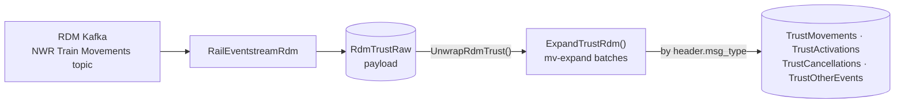

# Lab 04 – Ingest RDM Kafka Train Movements with Eventstream

**Time:** 30 minutes · **Previous:** [Lab 03](03-reference-data.md) · **Next:** [Lab 04b](04b-darwin-push-port.md) (optional) or [Lab 05a](05a-bridge-local.md)

## Objectives

* Connect the **Apache Kafka** source connector in Eventstream to the Rail Data Marketplace *NWR Train Movements* product.
* Land the raw messages in the Eventhouse table **`RdmTrustRaw`** (one dynamic `payload` column), where update policies (Lab 06) parse them.
* This lab is **TRUST only**. Darwin Push Port (forecasts and platforms) is a separate, optional lab: [Lab 04b](04b-darwin-push-port.md).

> **Shared Event Hub mode (optional, [Lab 05c](05c-shared-event-hub.md)).** If your instructor runs the shared Event Hub,
> **don't** add the Apache Kafka source below and you don't need your own RDM account. Instead, add an **Azure Event Hubs** source
> for the `rdm-trust` hub with your own consumer group (Lab 05c, step S2). The destination (`RdmTrustRaw`, `RdmTrustRawMapping`)
> and the checkpoint queries are the same.

## Prerequisites

* Lab 02 (Eventstream `RailEventstreamRdm`) is done.
* The table **`RdmTrustRaw`** and mapping **`RdmTrustRawMapping`** exist ([Lab 02, "Create the raw tables and mappings now"](02-fabric-workspace.md#create-the-raw-tables-and-mappings-now)).
  Check before you start. In a KQL queryset on `RailKQL`, run:

  ```kusto
  .show table RdmTrustRaw ingestion json mappings
  ```

  If it says the table doesn't exist, run `01_tables.kql` and `02_update_policies.kql` first (see Lab 02). **Don't** let the
  Eventstream wizard create the table: it builds its own columns, and the parsing in Lab 06 expects one `payload` column.
* The Kafka details from your RDM subscription page for the **NWR Train Movements** product: bootstrap server, **topic**,
  **consumer group**, consumer **username** and **password**. Each RDM product has its **own** topic and consumer group, so copy
  them from the *NWR Train Movements* product's subscription page. Take the username and password from the same page too – don't
  assume another product's credentials are the same.

> ⚠️ **Don't use the Darwin Push Port topic or consumer group here.** If you also subscribe to *Darwin Real Time Train
> Information (Push)*, its Kafka topic name mentions Darwin and Push Port (for example `...-Darwin-Train-Information-Push-Port-...`).
> Darwin has its own Eventstream and table in the optional [Lab 04b](04b-darwin-push-port.md). Mixing it into
> `RdmTrustRaw` gives you no `TrustMovements` rows.

## Option A – automated

Not available. The Eventstream topology (sources, destinations, operators) is configured in the portal. This repo
doesn't generate Eventstream definition payloads. Follow Option B.

## Option B – manual (portal)

> Portal labels change from time to time. If a label differs slightly, pick the closest match.

1. Open **RailEventstreamRdm** → **Add source** → **Connect data sources** → **Apache Kafka** → **Connect**.
2. Create a **new connection**:
   * **Bootstrap server**: from RDM (`host:port`; comma-separate multiple brokers)
   * **Connection name**: for example `rdm-kafka`
   * **Authentication kind**: **API Key**. This is the only option offered, and it's how Fabric stores SASL
     username/password credentials:
     * **Key** = your RDM Kafka **consumer username**
     * **Secret** = your RDM Kafka **consumer password**
   * Select **Connect**.

   > There's no separate "username/password" option in the Eventstream Kafka connection. The **Key** and **Secret**
   > are sent as the SASL username and password once you choose `SASL_SSL` / `PLAIN` in the next step.
3. Configure the source:
   * **Topic**: the **NWR Train Movements** topic from RDM (not the Darwin Push Port topic)
   * **Consumer group**: the **NWR Train Movements** consumer group from RDM. Use the exact value RDM issued
   * **Reset auto offset**: `Latest` for live demos, `Earliest` to backfill whatever the broker retains
   * **Security protocol**: `SASL_SSL`
   * **SASL mechanism**: `PLAIN` (not SCRAM)
   * Leave **TLS/mTLS settings** off. RDM's brokers use a publicly trusted certificate.
4. **Next** → **Add** → **Publish**. In **Data preview**, you should see JSON TRUST messages appear (if preview stays empty, see Troubleshooting – check the Eventhouse table instead).
5. **Add destination** → **Eventhouse**:
   * **Data ingestion mode**: **Direct ingestion**. Use this mode – it's the one that lets you pick an existing table and
     an existing mapping. (*Event processing before ingestion* derives its own columns from the JSON and doesn't offer
     existing mappings.)
   * **Destination name** (for example `RdmTrustRaw`), **Workspace** `rail-fabric-rti`, **Eventhouse** `RailEventhouse`,
     **KQL Database** `RailKQL` → **Save**.
   * Make sure the destination card is connected to the stream, then **Publish**.
6. Switch to **Live view**. On the Eventhouse destination node, select **Configure**. The Eventhouse **Get data** wizard opens:
   1. **Destination table**: choose the **existing** table **`RdmTrustRaw`**. *Don't* choose **New table** – if `RdmTrustRaw`
      isn't listed, the table hasn't been created yet (see Prerequisites and Troubleshooting).
   2. Keep the suggested **data connection name** → **Next**. Pulling sample events can take a few minutes.
   3. Select **RDMTrustRaw_mapping** dropdown and choose the option to use an **existing mapping**, then pick **`RdmTrustRawMapping`**. The preview
      should show a single column, `payload`, containing the whole message.
   4. **Finish** → **Close**.

   > The exact wording of the mapping option can vary between Fabric releases. If you can't find it, use **Edit columns**
   > so the table keeps **only** the `payload` column (type `dynamic`) mapped from the **whole record**, and remove any other
   > columns the wizard proposes. The Lab 06 update policies only read `payload`.

## How data moves from `RdmTrustRaw` to the parsed tables

There's no extra Eventstream step. The **update policies** you created with `02_update_policies.kql` (Lab 02) run
inside the Eventhouse every time a batch lands in `RdmTrustRaw`:



1. **`UnwrapRdmTrust()`** removes the RDM envelope when there is one (through the shared `UnwrapRdmBody()` function). Some RDM
   products (Darwin) deliver each message as a serialised ActiveMQ message (`destination`, `messageID`, `properties`, …) with the
   real feed JSON as a **string** in `bytes` (or `text`). **NWR Train Movements arrives without an envelope** – plain TRUST JSON –
   and passes straight through.
2. **`ExpandTrustRdm()`** expands batches (`mv-expand`), and the `Parse*()` functions route each TRUST message by `msg_type`
   into the `Trust*` tables, the same as the NROD bridge data. As a safety net it skips anything that looks like Darwin
   (destination contains `PushPort`, or the body has `uR`/`sR`).
3. Darwin Push Port has its own raw table (`RdmDarwinRaw`) and parsing; see the optional [Lab 04b](04b-darwin-push-port.md).

**Which product are you receiving?** This query labels each message by its content:

```kusto
RdmTrustRaw
| extend dest = tostring(payload.destination.name)
| extend feed = case(dest has "PushPort", "Darwin Push Port (wrong topic - see Lab 04b)",
                     isnotempty(tostring(payload.header.msg_type)), "NWR Train Movements (TRUST)",
                     isnotempty(dest), "Wrapped RDM message - check the topic",
                     "Unknown - inspect payload")
| summarize messages = count(), latest = max(ingestion_time())
    by feed, destination = iff(isempty(dest), "(none - normal for TRUST)", dest)
```

* **NWR Train Movements (TRUST)** with destination **`(none - normal for TRUST)`** → this is what you want. RDM delivers
  Train Movements as plain TRUST JSON (`header` + `body`) with **no** envelope, so there's no destination name. The `Trust*` tables fill.
* **Darwin Push Port** (destination like `...PushPort-v18`) → you connected the **Darwin** topic by mistake. To fix it:
  1. Edit the Apache Kafka source in **RailEventstreamRdm** and change the **topic** and **consumer group** (and the connection,
     if RDM gave different credentials) to the **NWR Train Movements** values → **Publish**.
  2. Clear the Darwin rows in `RailKQL` (run each command on its own):

     ```kusto
     .clear table RdmTrustRaw data
     ```

     ```kusto
     .clear table DarwinLocations data
     ```

  3. If you want Darwin as well, add it properly in [Lab 04b](04b-darwin-push-port.md).

Labs 06–11 (views, dashboards, data agent, Rayfin map) are built on **`TrustMovements`**, which this lab (or the NROD bridge in
Lab 05a/05b) fills.

**Update policies only process data ingested after they exist.** If messages reached `RdmTrustRaw` before you ran
`02_update_policies.kql` (or before you re-ran it with this version), back-fill them **once**:

```bash
python fabric/scripts/apply_kql.py --file fabric/kql/01_tables.kql           # tables and mappings (safe to re-run)
python fabric/scripts/apply_kql.py --file fabric/kql/02_update_policies.kql   # latest functions and policies (safe to re-run)
python fabric/scripts/apply_kql.py --file fabric/kql/08_backfill.kql         # run once only
```

(Or paste each whole file into a KQL queryset and run it. Run `01_tables.kql` before `02_update_policies.kql`.)

### Should Eventstream split arrays?

No. The update policies handle a single message object or a JSON array (batch), using `mv-expand`. You don't need an Eventstream operator.

## Checkpoint

1. Raw data is arriving (a row per minute with a non-zero count):

   ```kusto
   RdmTrustRaw | summarize n = count() by t = bin(ingestion_time(), 1m) | order by t desc
   ```

2. It's the right product. `feed` should be **NWR Train Movements (TRUST)**, and a blank destination (`(none - normal for TRUST)`) is expected:

   ```kusto
   RdmTrustRaw
   | extend dest = tostring(payload.destination.name)
   | extend feed = case(dest has "PushPort", "Darwin Push Port (wrong topic - see Lab 04b)",
                        isnotempty(tostring(payload.header.msg_type)), "NWR Train Movements (TRUST)",
                        isnotempty(dest), "Wrapped RDM message - check the topic",
                        "Unknown - inspect payload")
   | summarize messages = count(), latest = max(ingestion_time())
       by feed, destination = iff(isempty(dest), "(none - normal for TRUST)", dest)
   ```

3. Movements are parsed. Expect rows with `train_id`, `loc_stanox` and `delay_minutes` filled in:

   ```kusto
   TrustMovements | where source == "rdm" | take 10
   ```

4. The update policy is in place. The result lists `ParseMovements(ExpandTrustRdm())` with `Source` = `RdmTrustRaw`:

   ```kusto
   .show table TrustMovements policy update
   ```

If step 1 shows data but step 3 shows nothing, and the data arrived before the update policies existed, run
`08_backfill.kql` **once** (see above).

Labs 06–11 rely on **`TrustMovements`**. Darwin (forecasts and platforms) is optional: see [Lab 04b](04b-darwin-push-port.md).

## Troubleshooting

| Symptom | Fix |
|---|---|
| Source shows authentication errors | Check the connection's **Key** is the RDM consumer username and **Secret** is the RDM consumer password (no spaces). Check the mechanism is `PLAIN` and the protocol is `SASL_SSL`. To change them, edit the connection under **Settings → Manage connections and gateways** |
| Can't find a username/password option | Expected. Use **Authentication kind = API Key**: Key = username, Secret = password |
| Source runs but **Data preview** is empty or errors | Eventstream previews with a consumer group prefixed `preview-`, and the credentials need read access to it. RDM only grants your issued consumer group, so preview may fail even though ingestion works. Check the Eventhouse table (Checkpoint) instead |
| No data, no errors | Check the topic name and consumer group. Use `Latest` and wait a minute; it's a beta feed with no SLA |
| Destination shows `...PushPort...` / data is Darwin | You used the Darwin topic and consumer group. 1) Edit the Apache Kafka source: set the **NWR Train Movements** topic and consumer group (and credentials, if different) → **Publish**. 2) Run `.clear table RdmTrustRaw data`. 3) Run `.clear table DarwinLocations data`. 4) Add Darwin properly in [Lab 04b](04b-darwin-push-port.md) |
| Data in `RdmTrustRaw` but none in `TrustMovements` | Check which product you're receiving (Checkpoint step 2). If it's TRUST, re-run `01_tables.kql` then `02_update_policies.kql`, check `.show table TrustMovements policy update` lists `ParseMovements(ExpandTrustRdm())`, and look at `.show ingestion failures` |
| `destination` is blank | Expected for NWR Train Movements: its messages have no RDM envelope. Use the `feed` column from the "Which product" query |
| `E0080010: Permission check for the consumer group 'preview-…' failed` when adding or editing the source | Fabric's data preview uses its own `preview-` consumer group, which RDM doesn't grant. If the editor lets you continue, **Publish** and check `RdmTrustRaw` instead. If it blocks an **edit**, delete the Kafka source, **Publish**, and add a new Apache Kafka source with the correct topic and consumer group |
| `Query schema does not match table schema` mentioning `int,long` (for example when back-filling) | Your `ParseMovements()` is from before the `delay_minutes` fix. Re-run `02_update_policies.kql`, then back-fill once |
| `TrustMovements` empty although new TRUST data arrives | Check the update policy (Checkpoint step 4) and `.show ingestion failures \| where FailedOn > ago(1h)`. Test the parsing by hand with `ParseMovements(ExpandTrustRdm()) \| take 10`, and try a one-off back-fill (`.set-or-append TrustMovements <\| ParseMovements(ExpandTrustRdm())`): its error message shows the real problem. If data arrived before the policies existed, run `08_backfill.kql` once |
| Older rows never parsed | Expected: update policies only see new data. Run `08_backfill.kql` once |
| No existing `RdmTrustRaw` in the table list, or no "existing mapping" option | The table and mapping weren't created first. Run `01_tables.kql` and `02_update_policies.kql` (Lab 02), then re-open **Configure** on the destination |
| You already let the wizard create a **new** `RdmTrustRaw` table | Its columns won't match. Delete the Eventhouse destination in the Eventstream, run `.drop table RdmTrustRaw ifexists` in `RailKQL`, run `01_tables.kql` and `02_update_policies.kql`, then redo steps 5–6 |
| Only *Event processing before ingestion* settings shown (table + JSON, no mapping choice) | You picked that mode. Delete the destination and add it again with **Direct ingestion** |
| Duplicated movements | You're also ingesting `TRAIN_MVT_ALL_TOC` through the bridge. Filter on `source`, or drop one feed (see Lab 00) |
| Only part of the data arrives | Another consumer uses the same RDM consumer group, for example the instructor's RDM relay (Lab 05c) or a second Eventstream. Run only one reader per RDM consumer group |
