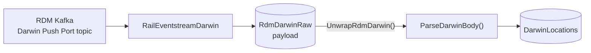

# Lab 04b – Add Darwin Push Port (optional)

**Time:** 25 minutes · **Previous:** [Lab 04](04-rdm-kafka-eventstream.md) · **Next:** [Lab 05a](05a-bridge-local.md)

> **Optional.** Labs 05–11 work without Darwin: they're built on `TrustMovements` from Lab 04. Do this lab if you want
> passenger-facing forecasts, actual times and platforms as well.

## Objectives

* Add **Darwin** forecasts, actual times and platforms for each service and calling point, alongside the TRUST movements from Lab 04.
* Connect a **second** Rail Data Marketplace Kafka product, *Darwin Real Time Train Information (Push)*, with its own topic and consumer group.
* Use a **separate Eventstream**, `RailEventstreamDarwin`, so the two feeds don't mix. All the sources in an Eventstream feed one
  default stream, so an Eventhouse destination on `RailEventstreamRdm` would receive TRUST **and** Darwin messages. A dedicated
  Eventstream keeps Darwin in its own raw table, **`RdmDarwinRaw`**, which update policies parse into **`DarwinLocations`**.

## Prerequisites

* [Lab 04](04-rdm-kafka-eventstream.md) is working: `TrustMovements | where source == "rdm" | take 10` returns rows.
* An RDM subscription to **Darwin Real Time Train Information (Push)**:
  <https://raildata.org.uk/dataProduct/P-3f10bf96-d8e8-4041-aa5e-d75d82c45c4e/overview>. From **that product's** subscription
  page, note the bootstrap server, **topic**, **consumer group**, consumer **username** and **password**. They aren't the
  NWR Train Movements values: each RDM product has its own topic and consumer group.
* The table **`RdmDarwinRaw`** and mapping **`RdmDarwinRawMapping`** exist, and the Darwin update policy reads from them. If you
  set up the database before this lab was added, re-run `01_tables.kql` and then `02_update_policies.kql` (safe to re-run).
  Check:

  ```kusto
  .show table RdmDarwinRaw ingestion json mappings
  ```

  **Don't** let the Eventstream wizard create the table: the parsing expects one `payload` column.

## Option A – automated

The Fabric items and the KQL are scripted. The Eventstream source and destination are portal-only (as in Lab 04).

```bash
./scripts/fabric-setup.sh           # or: ./scripts/fabric-setup.ps1 – also creates the empty RailEventstreamDarwin
python fabric/scripts/apply_kql.py --file fabric/kql/01_tables.kql
python fabric/scripts/apply_kql.py --file fabric/kql/02_update_policies.kql
python fabric/scripts/apply_kql.py --file fabric/kql/04_query_functions.kql   # Darwin query functions used below
```

Copy `FABRIC_EVENTSTREAM_DARWIN_ID` from the script output into `.env`. Then do Option B from step 2 to wire the source
and destination.

## Option B – manual (portal)

> Portal labels change from time to time. If a label differs slightly, pick the closest match.

1. If the script didn't create it: workspace → **+ New item** → **Eventstream** → `RailEventstreamDarwin`.
2. Open **RailEventstreamDarwin** → **Add source** → **Connect data sources** → **Apache Kafka** → **Connect**.
3. Create a **new connection**:
   * **Bootstrap server**: from the Darwin product page
   * **Connection name**: for example `rdm-kafka-darwin`
   * **Authentication kind**: **API Key**:
     * **Key** = your Darwin RDM Kafka **consumer username**
     * **Secret** = your Darwin RDM Kafka **consumer password**
   * Select **Connect**.

   > Reuse the Lab 04 connection only if RDM shows **the same** bootstrap server, username and password on both product pages.
4. Configure the source:
   * **Topic**: the **Darwin** topic from RDM
   * **Consumer group**: the **Darwin** consumer group from RDM. Use the exact value RDM issued
   * **Reset auto offset**: `Latest`
   * **Security protocol**: `SASL_SSL`
   * **SASL mechanism**: `PLAIN` (not SCRAM)
   * Leave **TLS/mTLS settings** off.
5. **Next** → **Add** → **Publish**. (If **Data preview** stays empty, see Troubleshooting – check the Eventhouse table instead.)
6. **Add destination** → **Eventhouse**:
   * **Data ingestion mode**: **Direct ingestion** (so you can pick an existing table and mapping).
   * **Destination name** (for example `to-RdmDarwinRaw`), **Workspace** `rail-fabric-rti`, **Eventhouse** `RailEventhouse`,
     **KQL Database** `RailKQL` → **Save**.
   * Make sure the destination card is connected to the stream, then **Publish**.
7. Switch to **Live view**. On the Eventhouse destination node, select **Configure**. The Eventhouse **Get data** wizard opens:
   1. **Destination table**: choose the **existing** table **`RdmDarwinRaw`**. *Don't* choose **New table** – if `RdmDarwinRaw`
      isn't listed, the table hasn't been created yet (see Prerequisites).
   2. Keep the suggested **data connection name** → **Next**. Pulling sample events can take a few minutes.
   3. Select the mapping dropdown (it shows a suggested name such as **RdmDarwinRaw_mapping**) and choose the option to use an
      **existing mapping**, then pick **`RdmDarwinRawMapping`**. The preview should show a single column, `payload`, containing
      the whole message.
   4. **Finish** → **Close**.

## How it's parsed



The update policy on `DarwinLocations` (`Source` = `RdmDarwinRaw`, query `ParseDarwinLocations()`) runs on every batch:

1. **`UnwrapRdmDarwin()`** removes the RDM envelope with the same `UnwrapRdmBody()` logic as Lab 04.
2. **`ParseDarwinBody()`** reads train status (`TS`) messages from `uR` (real-time updates) or `sR` (messages sent after a Darwin
   snapshot, when Darwin re-syncs its state) and writes **one row per service (`rid`) and location (`tiploc`)**.

| Column | Meaning |
|---|---|
| `rid`, `uid`, `ssd` | Darwin RTTI service ID, schedule UID and schedule start date |
| `tiploc` | Location (join to `Locations.tiploc` for names and coordinates) |
| `wta`, `wtd`, `wtp` | Working timetable arrival, departure and pass times |
| `pta`, `ptd` | Public (timetabled) arrival and departure times |
| `arr_at` / `arr_et`, `dep_at` / `dep_et`, `pass_at` / `pass_et` | Actual / estimated arrival, departure and pass times |
| `arr_delay_minutes`, `dep_delay_minutes` | Public time compared with the actual time (or the estimate if there's no actual yet), allowing for midnight |
| `platform`, `platform_confirmed`, `platform_source` | Platform, whether it's confirmed, and where it came from (`platsrc`) |
| `msg_ts`, `update_origin`, `source` (`rdm-darwin`), `received_utc` | Message timestamp, Darwin update origin, feed and ingestion time |

> Darwin times are **UK local time** strings (`HH:MM` or `HH:MM:SS`) on the schedule start date (`ssd`), not UTC datetimes.

### Sample queries

```kusto
DarwinLatest() | take 20                          // latest state per service and location, with names and coordinates
DarwinUnconfirmedPlatforms("LDS")                 // Leeds: services whose platform isn't confirmed yet
DarwinBiggestDelays()                             // biggest predicted or actual delays in the last hour
```

### Volume and retention

`RdmDarwinRaw` keeps 7 days and `DarwinLocations` 30 days (`01_tables.kql`). Darwin is much busier than TRUST, so keep an eye
on the Eventstream's throughput and on your capacity (Fabric Capacity Metrics app). Delete the Darwin source when you don't need it.

### Shared Event Hub mode (Lab 05c)

The Lab 05c RDM relay forwards **one** topic (NWR Train Movements) to the `rdm-trust` hub; Darwin isn't relayed. In shared mode,
either each student uses their own Darwin subscription with this lab, or the instructor runs a second relay instance pointed at
the Darwin topic, with its own hub and consumer groups. That second relay **isn't scripted** in this repo.

## Checkpoint

```kusto
RdmDarwinRaw | summarize n = count() by t = bin(ingestion_time(), 1m) | order by t desc
```

```kusto
RdmDarwinRaw | summarize messages = count() by destination = tostring(payload.destination.name)   // expect PushPort
```

```kusto
DarwinLocations | take 10
```

```kusto
.show table DarwinLocations policy update   // Source = RdmDarwinRaw, Query = ParseDarwinLocations()
```

- [ ] `RdmDarwinRaw` gets rows every minute, and `DarwinLocations` fills
- [ ] `RdmTrustRaw` still shows only NWR Train Movements (Lab 04, Checkpoint step 2)

## Troubleshooting

| Symptom | Fix |
|---|---|
| Source shows authentication errors | **Authentication kind** is **API Key**: Key = the Darwin consumer username, Secret = the Darwin consumer password. Check `SASL_SSL` / `PLAIN` |
| **Data preview** is empty or errors, or `E0080010: Permission check for the consumer group 'preview-…' failed` | Eventstream previews with a consumer group prefixed `preview-`, which RDM doesn't grant. If it blocks an edit, delete the source, **Publish** and add it again. Ingestion can still work: check `RdmDarwinRaw` (Checkpoint) |
| Darwin rows are in `RdmTrustRaw` (from before this lab) | They're not moved or back-filled. Point Lab 04 at the NWR Train Movements topic, then run `.clear table RdmTrustRaw data` and `.clear table DarwinLocations data` (each on its own). New Darwin data arrives through this lab |
| `DarwinLocations` empty although `RdmDarwinRaw` fills | Run `.show table DarwinLocations policy update`: `Source` must be `RdmDarwinRaw`. If not, re-run `01_tables.kql` then `02_update_policies.kql`. Check `.show ingestion failures`. Data that arrived before the policy existed needs `08_backfill.kql` (once) |
| No `RdmDarwinRaw` in the table list, or no "existing mapping" option | Run `01_tables.kql` and `02_update_policies.kql`, then re-open **Configure** on the destination |
| Looking for `HBINIT` / snapshot status messages | Darwin status messages are on a separate `darwin.status` topic. This lab doesn't need them |
| Only part of the data arrives | Another consumer uses the same Darwin consumer group. Run only one reader per RDM consumer group |
