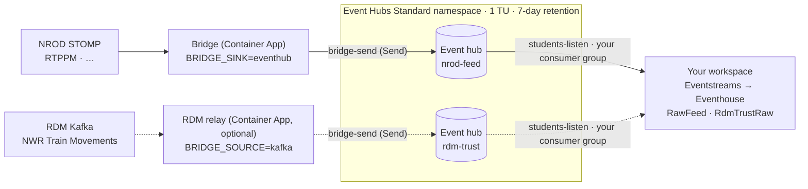

# Solo 1.8 – Optional: shared Azure Event Hub for a paused capacity

**Time:** 30 minutes · **Previous:** [Solo 1.7](1.7-bridge-azure.md) · **Next:** [Lab 2.1](../build/2.1-kql-transformations.md)

> **This page is optional.** The direct paths stay the default and keep working: RDM Kafka → Eventstream Apache Kafka
> source (Solo 1.4) and bridge → Eventstream custom endpoint (Solo 1.6/1.7). Skip this page if your Fabric capacity runs
> whenever the bridge does. Running a class? Use [Instructor 1.4](../instructor/1.4-shared-event-hub.md) instead.

## Objectives

* Put an **Azure Event Hubs (Standard)** namespace between the rail data sources and your Fabric workspace.
* Keep data flowing while your Fabric capacity is **paused overnight**, and let your Eventstreams catch up when it resumes.

## When to use it

| Situation | Direct paths (default) | Shared Event Hub (this page) |
|---|---|---|
| Capacity always on | ✅ Simplest | Not needed |
| Capacity paused overnight or at weekends | ❌ Bridge sends fail while the capacity is paused (see below) | ✅ Event Hubs keeps buffering for up to **7 days** |

### What happens to data while the capacity is paused?

* **Direct path (custom endpoint).** The bridge only ACKs a STOMP frame after the sink accepts it. While the capacity is
  paused, sends to the Eventstream custom endpoint are expected to fail (*validate this in your tenant – the exact error
  isn't documented*). Each failure raises `SinkError`: the bridge does **not** ACK the frame, increments `send_failures`,
  disconnects and reconnects with exponential backoff (30, 60, 120 … seconds, capped at `BACKOFF_MAX_S`, default 600 s; 25 minutes after an NROD `AMQ339009` block), then tries
  again with the redelivered frame. That loop is safe for short outages, but NROD only buffers a durable subscription for
  about **5 minutes**, so anything older than that is lost when the pause lasts longer. The Eventstream **Custom endpoint
  source doesn't support pause and resume** either ([Pause and resume data streams](https://learn.microsoft.com/en-us/fabric/real-time-intelligence/event-streams/pause-resume-data-streams)).
* **Shared Event Hub path.** The bridge and the RDM relay send to Azure Event Hubs, which doesn't depend on the Fabric
  capacity, so they keep running and ACK/commit normally. Event Hubs retains the events (7 days here). The Eventstream
  **Azure Event Hubs source supports pause/resume** with the resume options **When streaming was last stopped**, **Now**
  and **Custom time** (same page), so your Eventstream can pick up where it stopped.

> **Be honest with yourself about the overnight behaviour.** Microsoft documents pause/resume of an *Eventstream source*.
> What a source does after a full *capacity* pause and resume should be **validated** with the
> [overnight pause checkpoint](#overnight-pause-checkpoint). If the gap isn't back-filled automatically, use the documented
> fallback: **Deactivate** the source and **Activate** it with **Custom time** set to just before the pause.

## Architecture



| Piece | Setting | Why |
|---|---|---|
| Namespace tier | **Standard**, 1 throughput unit (TU) | Basic allows only **1 consumer group** per event hub and **1-day** retention. Standard allows up to **7 days** retention |
| Event hubs | `nrod-feed` (bridge envelope JSON → `RawFeed`), `rdm-trust` (raw RDM JSON → `RdmTrustRaw`) | Same tables and mappings as the direct paths |
| Retention | 7 days | Standard maximum. Covers nights and weekends |
| Send rule | `bridge-send` (**Send**) on each hub | Stored in Key Vault as `eventhub-nrod-connection-string` / `eventhub-rdm-connection-string` (not used with `EVENTHUB_AUTH=entra`) |
| Listen rule | `students-listen` (**Listen**) on the namespace | The script creates it for classes. You use it for your own Eventstreams (key sign-in only; with `EVENTHUB_AUTH=entra` you use workspace identity) |
| Consumer group | One for you, for example `solo01`, on **both** hubs | One consumer group per Eventstream reader |

## Costs (estimates)

List prices in USD from the [Event Hubs pricing page](https://azure.microsoft.com/pricing/details/event-hubs/) at the time of
writing. They're **estimates**: check the [Azure pricing calculator](https://azure.microsoft.com/pricing/calculator/) for your region and currency.

| Item | Estimate | Notes |
|---|---|---|
| Event Hubs **Standard**, 1 TU | $0.03/hour ≈ **$22/month** | Charged whether or not anyone reads |
| Ingress events | $0.028 per million | A few dollars a month for TRUST and RTPPM. See [Instructor 1.4 – Costs](../instructor/1.4-shared-event-hub.md#costs-estimates) for the working |
| RDM relay container app (0.25 vCPU / 0.5 GiB, always on) | **~$14/month** | Only with `DEPLOY_RDM_RELAY=true`. Same estimate as the bridge in Solo 1.7 |

Compare that with what you save by pausing the Fabric capacity overnight.

## Prerequisites

* Solo 1.1 and 1.7 done (the shared Key Vault, the Container Apps environment and the bridge exist), with `AZ_RESOURCE_GROUP`,
  `AZ_LOCATION` and `NAME_PREFIX` unchanged.
* Only if you'll also relay RDM: your RDM *NWR Train Movements* subscription details in `.env` (`RDM_KAFKA_*`, see Solo 1.4).
  The relay and your Solo 1.4 Apache Kafka source must not run at the same time with the same RDM consumer group, or the two
  consumers will split the partitions between them.

## 1. Create the Event Hub and your consumer group

1. Set the optional variables in `.env` (see `.env.example`). One consumer group is enough for one person:

   ```bash
   STUDENT_CONSUMER_GROUP_PREFIX=solo
   STUDENT_CONSUMER_GROUP_COUNT=1         # creates solo01 on both hubs
   EVENTHUB_THROUGHPUT_UNITS=1
   EVENTHUB_RETENTION_DAYS=7
   ```

2. Create the namespace, hubs, rules, Key Vault secrets (or `.env` values) and the consumer group:

   ```bash
   ./scripts/create-eventhub.sh --what-if     # optional preview
   ./scripts/create-eventhub.sh               # or: ./scripts/create-eventhub.ps1
   ```

   It prints `EVENTHUB_NAMESPACE` for your `.env`, and the Listen key (`students-listen`) you'll type into your
   Eventstream sources in step 3. Keep the key private. The script's full behaviour is described in
   [Instructor 1.4, Option A](../instructor/1.4-shared-event-hub.md#option-a--automated-instructor).

   **Key Vault blocked by policy?** If you deployed Solo 1.7 with `SECRETS_SOURCE=inline`, run this with the same choice.
   It then skips Key Vault and writes `EVENTHUB_NAMESPACE`, `EVENTHUB_CONNECTION_STRING` and
   `EVENTHUB_RDM_CONNECTION_STRING` (the **bridge-send** strings for `nrod-feed` and `rdm-trust`) straight into `.env`:

   ```bash
   SECRETS_SOURCE=inline ./scripts/create-eventhub.sh
   # PowerShell: ./scripts/create-eventhub.ps1 -SecretsSource inline   (or set SECRETS_SOURCE=inline in .env)
   ```

   Keep `.env` private and never commit it.

   #### Key sign-in blocked by policy? (EVENTHUB_AUTH=entra)

   A policy in many corporate subscriptions sets `disableLocalAuth: true` on Event Hubs namespaces. Then every shared
   access key is rejected, and the apps log `CBS Token authentication failed`. Check:

   ```bash
   az eventhubs namespace show -g $RG -n <namespace> --query disableLocalAuth
   # PowerShell: the same command
   ```

   If it returns `true`, use Microsoft Entra ID sign-in instead of keys:

   ```bash
   EVENTHUB_AUTH=entra ./scripts/create-eventhub.sh
   # PowerShell: ./scripts/create-eventhub.ps1 -Auth entra   (or set EVENTHUB_AUTH=entra in .env)
   ```

   It skips Key Vault and connection strings, writes `EVENTHUB_NAMESPACE` and `EVENTHUB_AUTH=entra` into `.env`, and
   doesn't print a Listen key. It also gives you **Azure Event Hubs Data Sender** on the namespace (only needed to run the
   bridge locally against the hub). Then let your own workspace read the hub:

   1. Open your Fabric workspace → **Workspace settings** → **Workspace identity** → enable it (you need the workspace
      **Admin** role).
   2. Copy the **ID** shown on that page (not the **App ID**) and give it the **Azure Event Hubs Data Receiver** role
      on the namespace:

      ```bash
      ./scripts/grant-eventhub-reader.sh --id <ID>
      # PowerShell: ./scripts/grant-eventhub-reader.ps1 -Id <ID>
      ```

      You need **Owner** or **User Access Administrator** on the namespace. It's safe to re-run. More detail in
      [Instructor 1.4](../instructor/1.4-shared-event-hub.md#key-sign-in-blocked-by-policy-eventhub_authentra).

   Use `EVENTHUB_AUTH=entra` in section 2 too, and **Workspace identity** in section 3.

## 2. Point the bridge at the hub

Re-run the Solo 1.7 deployment with `BRIDGE_TARGET=eventhub`:

```bash
BRIDGE_TARGET=eventhub ./scripts/deploy-bridge.sh                       # NROD bridge only
BRIDGE_TARGET=eventhub DEPLOY_RDM_RELAY=true ./scripts/deploy-bridge.sh  # also relay RDM Train Movements
# PowerShell: set BRIDGE_TARGET (and DEPLOY_RDM_RELAY) in .env, then ./scripts/deploy-bridge.ps1
```

With `BRIDGE_TARGET=eventhub` the bridge app reads `eventhub-nrod-connection-string` from Key Vault (instead of
`eventstream-connection-string`) and runs with `BRIDGE_SINK=eventhub`. With `DEPLOY_RDM_RELAY=true` the script also deploys
`<NAME_PREFIX>-rdm-relay`, which forwards RDM Train Movements to the `rdm-trust` hub. Without the relay, keep the Solo 1.4
Apache Kafka source for RDM. Remember that it then stops reading while the capacity is paused.

If you used `SECRETS_SOURCE=inline` in section 1, use it here too. The apps then get their secrets from `.env` instead of
Key Vault: `EVENTHUB_CONNECTION_STRING` and, with the relay, `EVENTHUB_RDM_CONNECTION_STRING`, which `create-eventhub`
has already written there:

```bash
SECRETS_SOURCE=inline BRIDGE_TARGET=eventhub DEPLOY_RDM_RELAY=true ./scripts/deploy-bridge.sh
```

If you used `EVENTHUB_AUTH=entra` in section 1, use it here too (add `SECRETS_SOURCE=inline` as well if Key Vault is
blocked by policy: Key Vault still holds the NROD and RDM credentials):

```bash
EVENTHUB_AUTH=entra BRIDGE_TARGET=eventhub DEPLOY_RDM_RELAY=true ./scripts/deploy-bridge.sh
# PowerShell: set EVENTHUB_AUTH=entra, BRIDGE_TARGET=eventhub and DEPLOY_RDM_RELAY=true in .env, then ./scripts/deploy-bridge.ps1
```

The apps' managed identity (`<NAME_PREFIX>-bridge-id`) gets the **Azure Event Hubs Data Sender** role on the namespace,
and the apps sign in with it instead of a connection string. A new role can take a few minutes to apply: until then the
logs show `sink send failed` and the apps retry on their own. `deploy-bridge` also starts stopped apps and restarts
running ones, so the new settings apply.

To run the bridge **locally** against the hub with `EVENTHUB_AUTH=entra`, use the venv (it signs in with your `az login`)
and run `pip install -r requirements.txt` again first (`azure-identity` was added). Docker can't use your `az login`.

## 3. Connect your Eventstreams to the hub

**NROD feed → `RawFeed`**

1. Open **RailEventstreamNrod** → **Edit** → **Add source** → **Connect data sources** → search **Azure Event Hubs** → **Connect**.
2. **Choose feature level**: **Basic**. Select **New connection**:
   * **Event Hub namespace**: your `EVENTHUB_NAMESPACE`. **Event Hub**: `nrod-feed`.
   * **Connection name**: for example `rail-nrod-feed`.
   * **Key sign-in (default):** **Authentication kind**: **Shared Access Key**. **Shared Access Key Name**: `students-listen`.
     **Shared Access Key**: the key from step 1 → **Connect**.
   * **`EVENTHUB_AUTH=entra`:** **Authentication kind**: **Workspace identity** → **Connect**. No key.
3. **Consumer group**: **your own** (`solo01`). Not `$Default`.
4. **Data format**: **JSON** → **Next** → **Add**.
5. Connect the source to the Eventhouse destination with table **`RawFeed`**, format **JSON** and mapping **`RawFeedMapping`**,
   exactly as in [Solo 1.6, A2 step 4](1.6-bridge-local.md#a2-connect-to-fabric-portal-set-up-then-run) → **Publish**.
   The bridge no longer sends to the `nrod-bridge` custom endpoint, so you can delete that source.

   *Direct ingestion* works. If you want to be able to rewind the destination too, choose *Event processing before ingestion*:
   that destination supports pause/resume with **Custom time**, whereas *Direct ingestion* doesn't (same Microsoft Learn page as above).

**RDM feed → `RdmTrustRaw`** (only if you deployed the relay)

1. In **RailEventstreamRdm**, **deactivate or delete the Apache Kafka source** from Solo 1.4 (the relay now uses that RDM consumer group).
2. Repeat the NROD steps with **Event Hub** `rdm-trust` (re-use the same connection if offered), the same consumer group
   (`solo01`), data format **JSON**, and destination table **`RdmTrustRaw`** with mapping **`RdmTrustRawMapping`**
   (as in [Solo 1.4](1.4-rdm-kafka-eventstream.md), steps 5–6).

### Checkpoint

```kusto
RawFeed | summarize events = count(), last_received = max(received_utc), last_ingested = max(ingestion_time()) by feed
RdmTrustRaw | summarize n = count() by t = bin(ingestion_time(), 1m) | order by t desc | take 10
TrustMovements | summarize n = count(), ['last'] = max(event_time) by source
```

In the Azure portal, the namespace → **Overview** → *Incoming Messages* rises every minute.

## Overnight pause checkpoint

Run this once on your own capacity **before** relying on it. It's the test the Microsoft documentation doesn't cover.

1. Note the time in UTC, then **pause** the Fabric capacity (Azure portal → your Fabric capacity → **Pause**).
2. Leave the bridge (and relay) running. In the Event Hubs namespace, *Incoming Messages* keeps rising while the capacity is paused.
3. Wait at least 30 minutes (or overnight). Note the resume time, then **Resume** the capacity.
4. After a few minutes, open each Eventstream. The Event Hubs source should show **Active**.
5. Compare event time with ingestion time. Events that happened during the pause but were ingested after the resume prove the gap was back-filled:

```kusto
let pause_start = datetime(2026-10-09 18:00);   // when you paused (UTC)
let resume_at   = datetime(2026-10-10 07:30);   // when you resumed (UTC)
RawFeed
| where received_utc between (pause_start .. resume_at)
| summarize events = count(), first_ingested = min(ingestion_time()), last_ingested = max(ingestion_time())
    by hour = bin(received_utc, 1h)
| order by hour asc
// Expect: every hour of the pause has events, and first_ingested is after resume_at.
```

```kusto
// RDM path (with the relay): TRUST event times during the pause, parsed by the Lab 2.1 update policies
TrustMovements
| where source == "rdm" and event_time between (datetime(2026-10-09 18:00) .. datetime(2026-10-10 07:30))
| summarize events = count(), max_ingested = max(ingestion_time()) by hour = bin(event_time, 1h)
| order by hour asc
```

`received_utc` is stamped by the bridge when NROD delivers a frame, so it shows when the event really happened even if
ingestion was hours later. `ingestion_time()` needs the table's IngestionTime policy, which is on by default.

**If hours are missing (gap not back-filled):**

1. Open the Eventstream → **Edit** → toggle the **Azure Event Hubs** source **off** (*Deactivate*).
2. Toggle it **on** (*Activate*) and choose **Custom time**, set to a few minutes **before** `pause_start`. It must be within
   the 7-day retention.
3. Overlapping events may arrive twice. De-duplicate in queries, for example
   `RawFeed | summarize take_any(*) by message_id, batch_index` for NROD.
4. Re-run the queries above.

Note which behaviour you saw (automatic catch-up or Custom time needed). It decides what you do each morning.

## Troubleshooting

| Symptom | Likely cause | Fix |
|---|---|---|
| Relay (or bridge) logs `CBS Token authentication failed` | The app is using a key the hub doesn't accept: a wrong or old connection string, or a secret that changed while the app kept running (a Container App only reads secrets when it starts) | Check the string is the `bridge-send` one for the right hub (`rdm-trust` for the relay). Then re-run `deploy-bridge`, which now restarts the apps, or restart by hand: `az containerapp revision restart -g $RG -n <prefix>-rdm-relay --revision <active revision>`. The log's `what to check` line lists these steps |
| `CBS Token authentication failed` although the connection string is right | A policy has set `disableLocalAuth: true` on the namespace, so keys are rejected | Check `az eventhubs namespace show -g $RG -n <namespace> --query disableLocalAuth`. If `true`, use [`EVENTHUB_AUTH=entra`](#key-sign-in-blocked-by-policy-eventhub_authentra) |
| With `EVENTHUB_AUTH=entra`, `sink send failed … Unauthorized` (or a CBS error) just after deploying | The new **Azure Event Hubs Data Sender** role for `<prefix>-bridge-id` is still spreading through Azure | Wait 5–10 minutes. Check with `az role assignment list --scope <namespace id> -o table` |
| Eventstream source won't connect with **Workspace identity** | Workspace identity isn't enabled, or it doesn't have **Azure Event Hubs Data Receiver** yet | Enable it in **Workspace settings** → **Workspace identity**, then copy the **ID** from that page (not the App ID) and run `./scripts/grant-eventhub-reader.sh --id <ID>`. Wait a few minutes and retry |
| `deploy-bridge` stops with `RDM_KAFKA_TOPIC looks like the Darwin Push Port topic` | `RDM_KAFKA_*` in `.env` holds the Darwin subscription, so the relay would send Darwin into `RdmTrustRaw` | Put the **NWR Train Movements** topic, consumer group, username and password in `RDM_KAFKA_*` (the same as your Solo 1.4 Kafka source). Darwin keeps its own source (Solo 1.5) |
| `create-eventhub` stops at the Key Vault step (denied by policy) or ends with `could not write secret` | A policy blocks public network access to Key Vault, so your machine can't write secrets | Re-run with `SECRETS_SOURCE=inline ./scripts/create-eventhub.sh` (PowerShell: `-SecretsSource inline`); re-running is safe. Then deploy with `SECRETS_SOURCE=inline` too (section 2) |
| Eventstream source errors mentioning `ReceiverDisconnected` or "a new receiver with higher epoch" | Two Eventstreams (or an Eventstream and another reader) use the **same consumer group** and keep taking the partitions from each other | Give every Eventstream reader its own consumer group |
| Source shows an authorisation error (`Unauthorized`, `401`, "put token failed") | Wrong key name or key, a hub-level key used with the wrong hub, or the key was rotated | Use key name `students-listen` with the **namespace-level** key |
| Source can't connect at all | Namespace isn't publicly reachable (firewall, private endpoint) | Keep public access on, or set up a Fabric managed private endpoint |
| After a long break, events older than 7 days are missing | Retention exceeded: Standard keeps at most 7 days | Resume within 7 days. For longer gaps use Premium (90 days) or Event Hubs Capture to storage |
| Custom time resume starts later than requested | Requested time is older than the retention | Same as above. Data older than the retention is gone |
| Bridge or relay logs `Event Hub send failed … ServerBusy` / throttling | More than 1 MB/s or 1,000 events/s in (for example, `TD_ALL_SIG_AREA` bursts) | Raise `EVENTHUB_THROUGHPUT_UNITS` and re-run `create-eventhub` |
| `Key Vault secret 'eventhub-…' not found` when you deploy | `create-eventhub` hasn't run, or ran in another resource group | Run step 1 first, with the same `AZ_RESOURCE_GROUP` and `NAME_PREFIX` |
| Relay logs SASL authentication errors | Wrong RDM username or password, or the subscription expired | Update the Key Vault secrets `rdm-kafka-username` / `rdm-kafka-password` (inline choice: update `.env` and re-run `deploy-bridge`), then restart the revision |
| Relay runs but `rdm-trust` gets only part of the data | Another consumer (your Solo 1.4 Eventstream Kafka source, or a local relay) uses the same RDM consumer group | Stop the other consumer. Only one reader per RDM consumer group |
| Duplicated rows after a relay or bridge restart | Delivery is at-least-once | De-duplicate in queries, as above |

## Clean-up

The namespace lives in `AZ_RESOURCE_GROUP`, so [Lab 2.10](../build/2.10-cleanup.md) removes it with everything else. To remove only this tier:

```bash
az eventhubs namespace delete -g rg-rail-fabric-rti -n <namespace>
BRIDGE_TARGET=eventstream DEPLOY_RDM_RELAY=false ./scripts/deploy-bridge.sh   # back to the direct path
az containerapp delete -g rg-rail-fabric-rti -n ${NAME_PREFIX:-railrti}-rdm-relay --yes
```

Then point your Eventstreams back at the direct sources (Solo 1.4 and Solo 1.6, A2).
